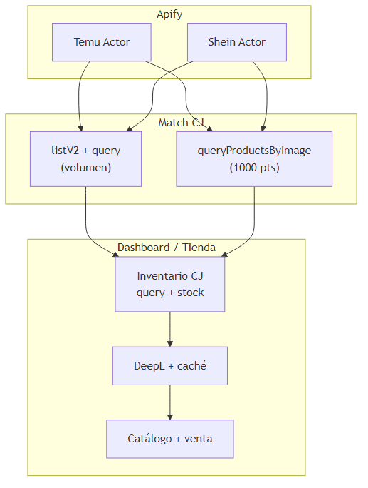
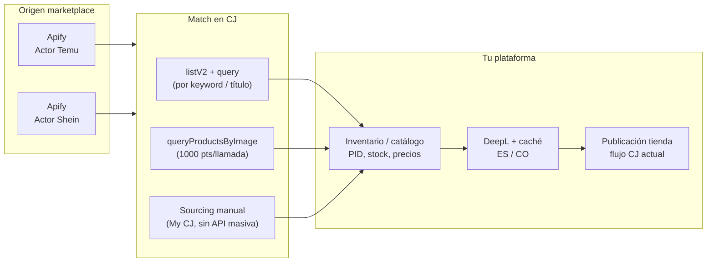

# Pipeline Temu/Shein → CJ → traducción — flujos y costos

> Anexo del plan único: [`PLAN_COMERCIAL_TIENDA_CJ.md`](./PLAN_COMERCIAL_TIENDA_CJ.md)

Documento para **completar la propuesta comercial**: dos orígenes (Apify Temu vs Apify Shein), emparejamiento en **CJ Dropshipping**, inventario con el flujo actual del dashboard, y **DeepL** para español (u otro idioma).

---

## 1. Flujo de negocio (dos caminos)





| Paso | Qué pasa | Salida |
|------|----------|--------|
| 1. Scraping | Actor Apify distinto por **Temu** o **Shein** (búsqueda por keyword/categoría/URL) | Título, imagen, precio referencia, URL origen |
| 2. Match CJ | Comprobar si existe equivalente en CJ | `pid`, SKU, costo CJ, stock |
| 3. Inventario | Mismo flujo que hoy: `product/query`, `stock/queryByPid`, margen | Ficha en catálogo del cliente |
| 4. Traducción | DeepL sobre título + descripción + atributos repetibles (caché) | Contenido en idioma destino |
| 5. Venta | Cotización envío, checkout, pedidos CJ (doc tienda) | — |

**Nota CJ “outsource”:** en la web CJ existe búsqueda por imagen y **sourcing request** manual; en API el equivalente automático más directo es **`/product/queryProductsByImage`** ([1000 puntos por llamada](https://developers.cjdropshipping.com/en/api/api2/standard/points.html)). No hay API documentada de “sourcing request” masivo como en My CJ. Para **5 000 productos**, el match por **keyword** (`listV2` + `product/query`) escala mejor que 5 000 búsquedas por imagen.

---

## 2. Precio al cliente — scraping (tu tabla)

| Productos | Precio al cliente (USD) | USD / producto |
|-----------|-------------------------|----------------|
| 1,000 | $15 | $0.015 |
| 2,500 | $37.50 | $0.015 |
| 5,000 | $75 | $0.015 |
| 10,000 | $150 | $0.015 |

Opcional **servicio traducción** cobrado aparte (ej. mismo $0.015/producto) → mejora margen (ver §6).

---

## 3. Apify — actors **variables** (fase exploración)

Los actors **no están fijados**: se prueban varios en Temu y Shein hasta el que mejor devuelva **título, imagen, precio, URL y categoría** con la menor tasa de bloqueo. Hasta entonces, presupuestar con **bandas**, no con un actor único.

| Fase | Qué hacer | Presupuesto Apify |
|------|-----------|-------------------|
| **R&D** | 2–4 actors por marketplace, runs de 50–200 ítems | **$20–80** one-off (crédito Apify + pruebas) |
| **Piloto** | 1 actor candidato por canal | Costo real × filas; recalcular $/1 000 |
| **Producción** | Congelar actor + versión en contrato interno | Banda baja–alta §3.3 |

### 3.1 Temu (referencias de mercado — no contrato final)

| Actor (referencia) | Tarifa orientativa | Notas |
|--------------------|-------------------|--------|
| [scrapesage/temu-scraper](https://apify.com/scrapesage/temu-scraper) | **~$1.10 / 1 000 productos** | ~$0.0011 / producto devuelto |
| [luminar/temu-product-scraper-price-monitor](https://apify.com/luminar/temu-product-scraper-price-monitor) | **$0.0014 / producto** + **~$0.10 / búsqueda** | 100 productos en 1 search ≈ $0.24 |
| [pear_fight/temu-scraper](https://apify.com/pear_fight/temu-scraper) | ~$1.50 / 1 000 | Run típico $0.25–1.00 |

### 3.2 Shein (ejemplos de mercado)

| Actor (referencia) | Tarifa orientativa | Notas |
|--------------------|-------------------|--------|
| [omkar-cloud/shein-scraper](https://apify.com/omkar-cloud/shein-scraper) | **$0.50 / 1 000** estándar; **$2 / 1 000** detalle completo | ~10 000 productos/mes “gratis” con crédito Apify $5 (plan free) |
| [native_emblem/shein-product-scraper](https://apify.com/native_emblem/shein-product-scraper) | $5–10 / 1 000 según modo | Más detalle = más caro |

### 3.3 Banda de costo Apify (hasta fijar actor)

| Volumen scrape | Temu (USD) | Shein (USD) |
|----------------|------------|-------------|
| 500 filas | **$0.55 – 4** | **$0.25 – 2.5** |
| 5 000 filas | **$5.5 – 35** | **$2.5 – 15** |

Incluye posibles **fees por búsqueda** ($0.10 c/u en algunos actors) y modo detalle vs listado.

---

## 4. DeepL API — cuándo cobra

| Concepto | Detalle |
|----------|---------|
| Gratis / mes (API Free) | **500 000 caracteres** |
| Cobro extra | Desde carácter **500 001** → plan **API Pro**: **$5.49/mes** fijo + **$25 / millón** de caracteres |
| Supuesto por producto | **~400 caracteres**, 1 idioma (título + descripción corta + variantes) |
| Productos en franja gratis | ~**1 250** sin caché |
| Con caché ~30% ahorro | ~**1 785** en franja gratis |

**Verificar con DeepL:** si Pro **no** descuenta los 500k gratis, sumar ~**$12.50** a cada fila de costo desde **2 500 productos** hacia arriba (como indicaste).

### Costo traducción (1 idioma, incluye $5.49 Pro cuando aplica)

| Productos | Caracteres (~400 c/u) | Sin caché | Con caché ~30% |
|-----------|------------------------|-----------|----------------|
| **500** (verificados CJ) | **200 000** | **$0** | **$0** |
| 1 | 400 | $0 | $0 |
| 1 250 | 500 000 | $0 | $0 |
| 2 500 | 1 000 000 | **~$18** | **~$5.49** |
| 5 000 | 2 000 000 | **~$43** | **~$28** |
| 10 000 | 4 000 000 | **~$93** | **~$65** |

Fórmula (después de agotar gratis, escenario conservador **con** descuento 500k en Pro):

```
Caracteres facturables = max(0, total_chars × (1 - cache_save) - 500_000)
Costo DeepL ≈ 5.49 + (Caracteres facturables / 1_000_000) × 25
```

### 4.1 Caso fijo: **500 productos ya verificados en CJ** (solo traducción)

Aquí el scrape y el match **ya terminaron**; solo traduces textos que vienen de CJ (`product/query`: `nameEn`, descripción, variantes). **No** se vuelve a pagar Apify por esos 500.

| Supuesto chars/producto (1 idioma) | Caracteres totales | ¿Dentro 500k/mes? | Costo DeepL API | Con caché ~30% |
|-----------------------------------|--------------------|-------------------|-----------------|----------------|
| 300 (título + bullets cortos) | 150 000 | Sí | **$0** | **$0** |
| **400 (estimación base)** | **200 000** | **Sí** | **$0** | **$0** |
| 600 (descripción media) | 300 000 | Sí | **$0** | **$0** |
| 800 (descripción larga) | 400 000 | Sí | **$0** | **$0** |
| 1 000 | 500 000 | Límite exacto | **$0** | **$0** |
| 1 200 | 600 000 | No (100k sobre free*) | **~$5.49**† | **~$5.49**† |

\*En el mes donde **solo** traduces estos 500 y no superas 500k en otros jobs.  
†Escenario Pro con 500k descontados: `5.49 + (100_000/1M)×25 ≈ $7.99`. Si Pro **no** descuenta free: ~**$20.49** (`5.49 + 600k×25/1M`).

**Qué traducir por SKU (checklist):**

- Título (`nameEn` → ES)
- Descripción HTML (texto plano, sin re-traducir URLs)
- Nombres de variantes repetidos → **caché DeepL** (mismo “Color: Red” en muchos PID)

**Cobro al cliente (si traducción es servicio aparte, $0.015/producto):**

| Concepto | Monto |
|----------|-------|
| Ingreso 500 × $0.015 | **$7.50** |
| Costo DeepL (400 c/u, plan Free) | **$0** |
| **Margen traducción** | **$7.50** (menos tiempo operativo) |

**CJ API al publicar 500 verificados** (sin re-match): ~500 × `query` (10 pts) = **5 000 pts**; stock opcional +5 000 pts — cabe en cuota diaria base.

---

## 5. CJ API — coste marginal del match (puntos, no USD directo)

| Estrategia match | Llamadas típicas / producto | Puntos / producto (aprox.) |
|------------------|----------------------------|----------------------------|
| **Keyword** (recomendado volumen) | Compartir `listV2` entre muchos SKU + `query` | ~10–60 (amortizado) |
| **Imagen** | 1× `queryProductsByImage` + `query` | **~1010** |
| Inventario | `stock/queryByPid` | 10 |

**5 000 productos solo por imagen:** ~5 000 × 1000 = **5 M puntos** → inviable en un día con base 50k; usar keyword o sourcing manual para lote grande.

---

## 6. Ejemplo **1 producto** (unit economics)

Supuestos: Temu scrapesage; match CJ por keyword (1× `listV2` amortizado + 1× `query`); 400 caracteres DeepL; cobras **$0.015** scraping.

| Concepto | Costo tuyo (USD) | Ingreso cliente | Notas |
|----------|------------------|-----------------|--------|
| Apify Temu (1 fila) | **~$0.0011** | — | +$0.10 search si no amortizas (1 solo SKU) |
| Apify Shein estándar (1 fila) | **~$0.0005** | — | Detalle completo ~$0.002 |
| CJ API (keyword) | ~$0* | — | *Incluido cuenta cliente; ~60 pts |
| CJ API (solo imagen) | ~$0* | — | 1000 pts — evitar en unit tests masivos |
| DeepL | **$0** | — | Dentro de 500k/mes |
| **Cobro scraping** | — | **$0.015** | |
| **Margen bruto (Temu, sin $0.10 search)** | | **~$0.014** | |
| **Margen (1er producto de un search)** | | **~$0.014 − 0.10** | Pierdes en el primero; se compensa en lote |

Shein suele ser **más barato** por fila en Apify; Temu puede sumar **fee por búsqueda** según actor.

---

## 7. Ejemplo **5 000 productos** (escalado)

### 7.1 Ingresos (solo scraping a $0.015)

| Concepto | Monto |
|----------|-------|
| Cobro al cliente | **$75.00** |

### 7.2 Costos variables (tu lado)

| Concepto | Bajo | Alto | Cálculo |
|----------|------|------|---------|
| Apify Temu | **$5.50** | **$35** | 5000 × $0.0011 ≈ $5.5; alto = searches + detalle + proxies |
| Apify Shein (estándar) | **$2.50** | **$15** | 5000 × $0.0005 ≈ $2.5 |
| DeepL (con caché) | **$28** | **$28** | Tabla §4 |
| DeepL (sin caché) | **$43** | **$43** | |
| CJ puntos (keyword) | — | — | Orden ~50k pts/día con cola QPS; planear días o caché match |

### 7.3 Resumen margen (Temu + DeepL caché, como tu investigación)

| Concepto | Monto (USD) |
|----------|-------------|
| Ingreso scraping | $75 |
| − Apify (estimado) | $5.50 – 35 |
| − DeepL caché | ~$28 |
| **= Margen estimado** | **$12 – 41** |

Si **cobras traducción aparte** ($0.015 × 5 000 = **$75** adicionales):

| Concepto | Monto |
|----------|-------|
| Ingreso total servicios | $150 |
| Costos (Apify + DeepL caché) | ~$33 – 63 |
| **Margen ampliado** | **~$87 – 117** |

*(Sin contar AWS, tiempo humano, fallos de match CJ, ni re-scraping.)*

---

## 8. Tasa de match CJ **por categoría** (variable)

El **% de match no es global**: depende de la categoría Temu/Shein y de si CJ tiene catálogo equivalente (electrónica genérica suele ir mejor que moda ultra de marca).

| Tipo categoría (ejemplo) | Match CJ orientativo | Scrape necesario para **500 verificados** |
|--------------------------|----------------------|-------------------------------------------|
| Accesorios / hogar genérico | **55 – 70 %** | **715 – 910** filas scrape |
| Belleza / uñas / gadgets | **45 – 60 %** | **833 – 1 111** |
| Ropa / moda | **30 – 50 %** | **1 000 – 1 667** |
| Electrónica con marca | **20 – 40 %** | **1 250 – 2 500** |
| Juguetes / seasonal | **40 – 55 %** | **909 – 1 250** |

Fórmula:

```
filas_scrape ≈ 500 / tasa_match_categoría
costo_apify ≈ filas_scrape × (USD_por_fila_del_actor_elegido)
```

**Contrato comercial sugerido:** cobrar scraping por **fila procesada** o por **SKU verificado en CJ** (los 500), no solo por scrape bruto — así el riesgo de categoría difícil queda explícito.

Escenarios globales (promedio mezclado):

| Match rate medio | Verificados / 5 000 scrape |
|------------------|----------------------------|
| 70 % | 3 500 |
| 50 % | 2 500 |
| 30 % | 1 500 |

---

## 9. Checklist implementación

1. **Benchmark actors** (Temu + Shein) con misma keyword; quedarse con el mejor JSON/costo; luego congelar versión.
2. Match automático: **normalizar título** → `listV2` → score similitud → `query` ganador.
3. Reservar **`queryProductsByImage`** para excepciones (alta confianza, bajo volumen).
4. **Caché DeepL** por hash de texto fuente (colores/tallas repetidas).
5. Medir **caracteres reales** en 50 productos piloto y recalcular §4.
6. Confirmar política DeepL Pro vs 500k gratis.

---

## 10. Relación con otros docs

- Arquitectura tienda + AWS: [`DIAGRAMA_ALTO_NIVEL.md`](./DIAGRAMA_ALTO_NIVEL.md)
- Facturación CJ + AWS: [`FACTURACION_CJ_ESCALABLE.md`](./FACTURACION_CJ_ESCALABLE.md) / `.docx`
- Endpoints CJ post-match: [`CJ_ENDPOINTS_TIENDA.md`](./CJ_ENDPOINTS_TIENDA.md)

*Versión 1.1 — actors variables; match por categoría; bloque 500 verificados CJ + DeepL.*
