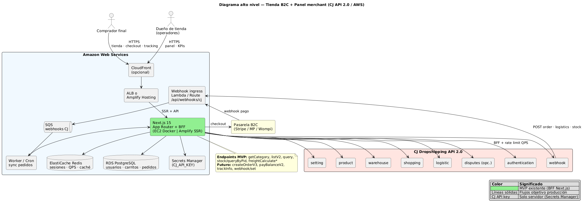
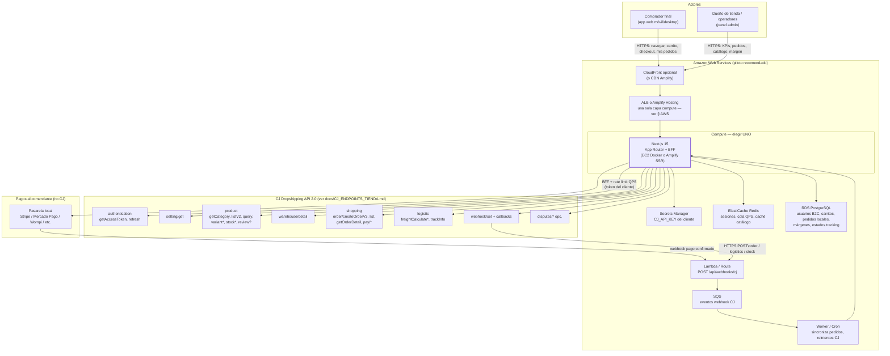
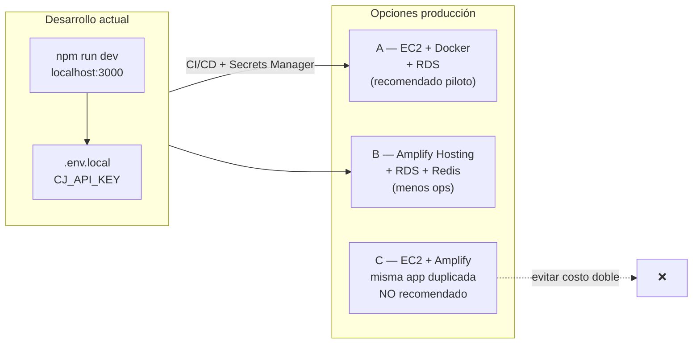
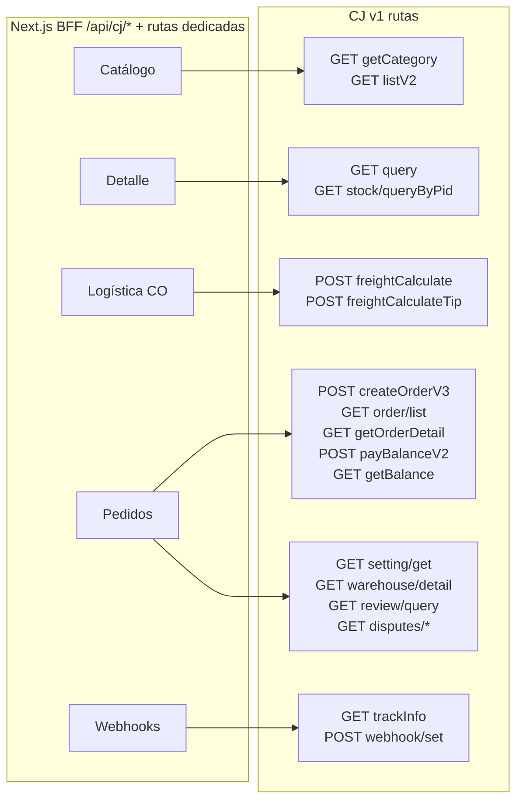
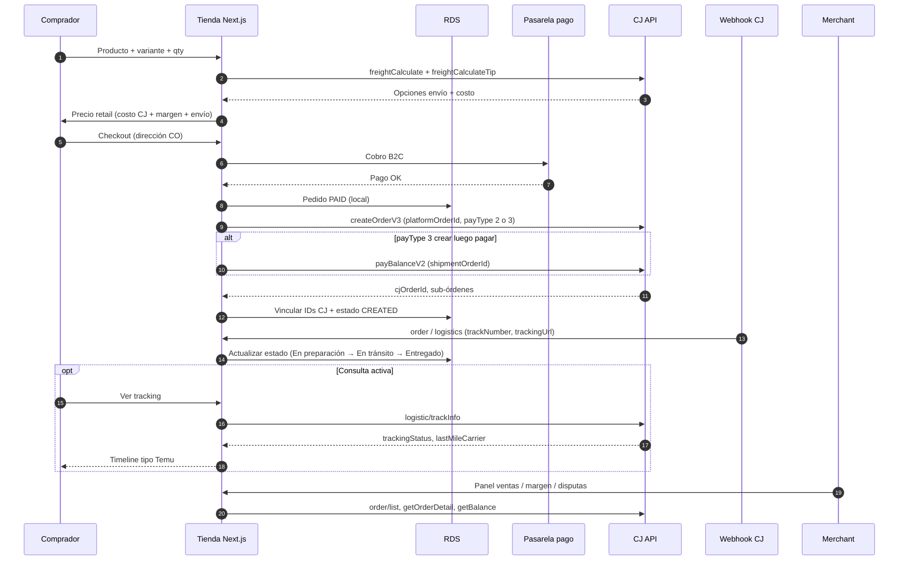
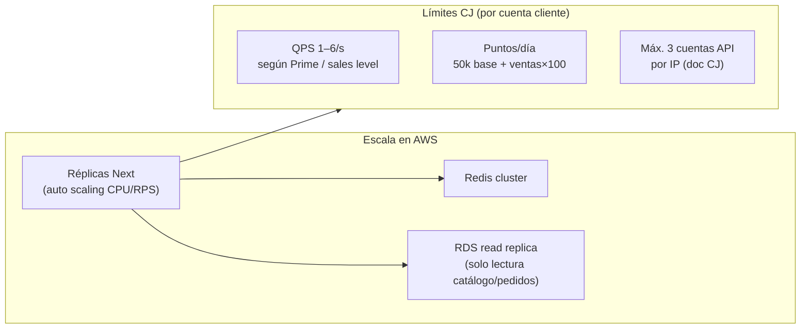

# Diagrama de alto nivel — Tienda tipo Temu/Shein sobre CJ (AWS)

> **Documento único (arquitectura + costos + ejemplos 1 / 5 000):** [`PLAN_COMERCIAL_TIENDA_CJ.md`](./PLAN_COMERCIAL_TIENDA_CJ.md) · [`PLAN_COMERCIAL_TIENDA_CJ.docx`](./PLAN_COMERCIAL_TIENDA_CJ.docx)

**Alcance:** una tienda B2C para compradores finales + panel del **cliente dueño de tienda** (su `CJ_API_KEY`). Despliegue en **AWS**. Objetivo: catálogo, checkout, pagos al comerciante, fulfillment y **tracking** vía CJ API 2.0 + webhooks.

**Leyenda**

| Símbolo | Significado |
|---------|-------------|
| Línea sólida | Flujo objetivo del producto |
| Caja con borde grueso | Ya existe en el repo (MVP catálogo/detalle/cotización CO) |
| Caja punteada | Por implementar (pedidos, pagos B2C, webhooks, auth multi-usuario) |

Referencias CJ: [API V2.0](https://developers.cjdropshipping.com/en/api/api2/), [Shopping](https://developers.cjdropshipping.com/en/api/api2/api/shopping.html), [Logistics / trackInfo](https://developers.cjdropshipping.com/en/api/api2/api/logistic.html), [Webhooks](https://developers.cjdropshipping.com/en/api/api2/api/webhook.html), [API Points](https://developers.cjdropshipping.com/en/api/api2/standard/points.html).

## Imágenes exportadas (UML / arquitectura)

| Archivo | Formato | Descripción |
|---------|---------|-------------|
| [diagrama-alto-nivel.png](./diagrams/diagrama-alto-nivel.png) | **PlantUML** (componentes + actores) | **Principal — estilo UML** para slides y DOCX |
| [diagrama-alto-nivel.svg](./diagrams/diagrama-alto-nivel.svg) | PlantUML vector | Editable en Illustrator / Figma (import SVG) |
| [diagrama-alto-nivel-completo.png](./diagrams/diagrama-alto-nivel-completo.png) | Mermaid | Vista completa con todos los módulos CJ |
| [diagrama-01-contexto.png](./diagrams/diagrama-01-contexto.png) | Mermaid | Vista resumida |

Regenerar: `npm run docs:diagrams` (fuente PlantUML: [`diagrams/diagrama-alto-nivel.puml`](./diagrams/diagrama-alto-nivel.puml)).

---

## Diagrama 1 — Contexto y contenedores (vista única principal)

> Si el renderizador falla por tamaño, usar los diagramas 2 y 3 más abajo (misma información, partida).

### Qué hace cada bloque

| Contenedor | Responsabilidad |
|------------|-----------------|
| **Next.js (BFF)** | Una sola salida a CJ desde servidor; cola **QPS**; proxy actual `/api/cj/*`, auth `/api/auth/*`, cotización CO; futuro: checkout, órdenes, webhooks. |
| **RDS** | Fuente de verdad **de la tienda** (cuentas compradores, carrito, `platformOrderId` ↔ CJ, precio venta, estado UI tipo Temu). CJ sigue siendo fuente de fulfillment. |
| **Redis** | Caché catálogo (hoy en browser; en producción también server-side), sesiones, deduplicación webhooks. |
| **PSP** | El **comprador paga al cliente** (precio retail + envío mostrado). CJ **no** cobra tarjeta al consumidor final en este modelo. |
| **CJ Wallet** | Tras venta confirmada, el **cliente** paga producto+envío a CJ (`payBalanceV2` o `payType=2` en create). |

---

## Transición: local (hoy) → AWS

| Criterio | **EC2 básico** (t3.small) | **Amplify básico** (Hosting) |
|----------|---------------------------|------------------------------|
| Despliegue | Docker / PM2, tú gestionas parches | Git push, build automático |
| Next.js API + BFF | Natural, proceso always-on | SSR + Route Handlers soportados |
| Cola QPS CJ (1 req/s) | OK en **1 instancia**; al escalar → Redis | Con varias instancias **Redis obligatorio** |
| Webhooks CJ (&lt;3 s) | URL estable vía ALB + ACM | URL estable dominio Amplify |
| Cron / workers | cron en EC2 o EventBridge | Lambda + EventBridge aparte |
| Costo piloto/mes | ~**$70–130** (EC2+RDS) | ~**$90–160** (build SSR+RDS) |
| Cuándo elegir | Control, workers, IP fija CJ | Equipo pequeño, deploy rápido |

**Nota:** CloudFront puede ir delante de **EC2** (origen ALB). Amplify ya incluye CDN; no hace falta **EC2 + Amplify** para la misma app Next — elige uno u otro.

---

## Diagrama 2 — Mapa BFF → endpoints CJ

Detalle tabular: [`CJ_ENDPOINTS_TIENDA.md`](./CJ_ENDPOINTS_TIENDA.md).

---

## Diagrama 3 — Flujo de compra y tracking (estilo marketplace)

### Estados de pedido sugeridos (UI)

| Estado UI (comprador) | Origen |
|----------------------|--------|
| Pendiente pago | Local + PSP |
| Pagado / confirmado | PSP webhook |
| Procesando en almacén | Webhook `order` CJ |
| Enviado | `trackNumber` + webhook `logistics` |
| En tránsito / última milla | `trackInfo` |
| Entregado | `trackInfo.trackingStatus` |
| Incidencia / disputa | Módulo disputes CJ + soporte local |

---

## Diagrama 4 — Escalabilidad de usuarios (pendiente volumen exacto)

Modelo **una tienda / un tenant / una CJ_API_KEY** (la del cliente). Escala horizontal del **compute**; límites duros en **CJ QPS + puntos API**.

| Fase | Compradores concurrentes (orientativo) | Acciones |
|------|----------------------------------------|----------|
| **S** | &lt; 500 DAU | 1–2 instancias Next, Redis pequeño, cola QPS 1/s |
| **M** | 500–5k DAU | Auto-scaling, caché agresivo catálogo, webhooks vs polling, evaluar CJ Prime (QPS) |
| **L** | 5k+ DAU | Read replicas, CDN assets, NAT/IP dedicada si varias cuentas CJ, monitoreo `pointsInfo` |

---

## Mapa MVP actual → producto Temu-like

| Capacidad | Estado repo | API CJ principal |
|-----------|-------------|------------------|
| Catálogo / categorías / 500 ítems | Hecho | `getCategory`, `listV2` |
| Ficha producto / variantes | Hecho | `product/query` |
| Inventario | Hecho | `stock/queryByPid` |
| Cotización envío Colombia | Hecho | `freightCalculate`, `freightCalculateTip` |
| Auth token servidor | Hecho | `getAccessToken` |
| Carrito / checkout B2C | Pendiente | — + PSP |
| Crear y pagar pedido CJ | Pendiente | `createOrderV3`, `payBalanceV2` |
| Listado pedidos merchant | Pendiente | `order/list`, `getOrderDetail` |
| Tracking comprador | Pendiente | `trackInfo` + webhook `logistics` |
| Alertas stock/precio | Pendiente | webhook `stock`, `product` |
| Login compradores / admin | Pendiente | Cognito o NextAuth + RDS |

---

## Decisiones ya tomadas (para el diagrama)

1. **CJ_API_KEY del cliente** → almacenada en **Secrets Manager**; nunca en el cliente browser.
2. **AWS** → piloto: **EC2 + RDS** *o* **Amplify + RDS** (no duplicar ambos computes); webhooks HTTPS; `CJ_API_KEY` en Secrets Manager.
3. **Pagos consumidor** → pasarela del comerciante; **pagos CJ** → wallet del mismo cliente en CJ.
4. **Un diagrama principal + dos de apoyo** (secuencia compra + escala) para no saturar una sola figura.

Documento de costos y facturación: [`FACTURACION_CJ_ESCALABLE.docx`](./FACTURACION_CJ_ESCALABLE.docx) (y fuente Markdown [`FACTURACION_CJ_ESCALABLE.md`](./FACTURACION_CJ_ESCALABLE.md)).
